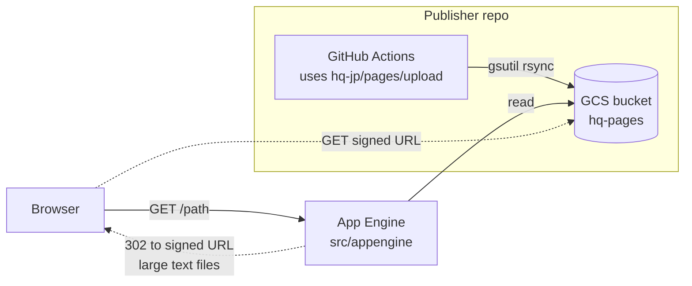

# Architecture

HQ Pages is an internal document sharing system for HQ. Other repositories publish static files (HTML, Markdown, images, and so on) into a GCS bucket from CI, and a small Express app on App Engine serves that bucket over HTTP. A file stored at `gs://hq-pages/foo/bar.html` is served at `/foo/bar.html`.

This repository contains two things. One is the App Engine app that reads the bucket. The other is the composite GitHub Action that other repositories use to write to it.

Last reviewed: 2026-11-04.

## System overview



The write path and the read path never touch each other. Publishers write straight to GCS. The app only reads.

## Code map

```
src/appengine/
  main.ts                 Express app and the whole request routing logic
  render/indexPage.ts     Directory listing via bucket.getFiles with delimiter "/"
  render/singleFile.ts    Streams one GCS object to the response
  utils/                  Small helpers (GoogleError guard, trailing slash)
  views/index.pug         Directory listing template
upload/action.yml         Composite action that publishers call to sync a directory to the bucket
.github/workflows/        deploy.yml deploys the app on push to main, test.yml runs lint
app.yaml                  App Engine runtime config
cors.json                 Bucket CORS policy, needed for signed URL redirects
biome.json                Formatter and linter config
.tool-versions            Node version for asdf and the Test workflow
```

## Request routing

All logic lives in `src/appengine/main.ts`. For `GET /<name>`:

1. If `<name>` is non-empty and has no trailing slash, and an object with exactly that name exists, serve it.
   - If its extension is in the text allowlist (`css json xml txt md csv tsv`) and it is larger than 500 KB, redirect to a V4 signed URL that expires in 60 seconds.
   - Otherwise stream it through the app with `renderSingleFile`. The `Content-Type` comes from the GCS object metadata.
2. Otherwise treat `<name>` as a directory. If `<name>/index.html` exists, serve it.
3. Otherwise render a listing of objects and sub-prefixes under `<name>/`. An empty listing returns 404.

`.js` is deliberately not in the signed URL allowlist. Scripts often build relative URLs from their own location, and those break when the script is served from a signed GCS URL.

There is no cache, no database, and no state in the app. GCS is the only data store.

## Invariants

- The app never writes to GCS.
- The URL path maps one to one to the object name. There is no rewriting except the `index.html` fallback.
- The app contains no authentication or authorization code. Access control must sit in front of App Engine and is managed outside this repository.
- Namespaces are the first path segment and belong to the publishing repository. `upload` runs `gsutil rsync -d`, so it deletes anything in its namespace that is not in the source directory.

## Deployment and infrastructure

- GCP project `hq-pages`. App Engine standard, runtime `nodejs24` (`app.yaml`). Bucket `hq-pages`.
- `.github/workflows/deploy.yml` runs `gcloud app deploy` on every push to `main`. App Engine runs the `gcp-build` script, which compiles TypeScript in place. `app.yaml` sets no environment variables, so production runs on the defaults in the code (see `README.md`).
- CI authenticates with Workload Identity Federation as `github-actions@hq-pages.iam.gserviceaccount.com`. The pool, providers, and IAM bindings are managed in `hq-jp/monorepo` under `infrastructure/terraform/gcp/projects/hq-pages`. The deploy workflow and the upload action use different pools (`github-actions` and `github-actions-v2`).
- `cors.json` is applied to the bucket by hand (`gsutil cors set cors.json gs://hq-pages`). Nothing in CI applies it.

## Security notes

- Signed URL redirects hand the browser a URL that reads the object directly from GCS, bypassing whatever proxy guards App Engine. It is valid for 60 seconds.
- Any repository that can authenticate as the CI service account can overwrite or delete any namespace in the bucket. Namespaces are a convention, not an access boundary.

## Known debt

- There is no custom error handler. A GCS error in a route handler goes to the Express 5 default handler and becomes a plain 500.
- There are no tests. CI runs only `npm run lint`, not `npm run typecheck`.

## Glossary

- **Namespace.** The top-level directory in the bucket owned by one publishing repository. Set by the `namespace` input of the upload action.
